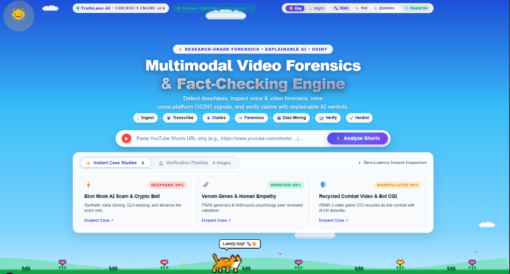
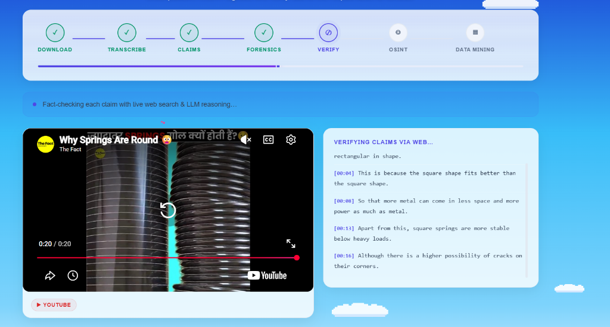
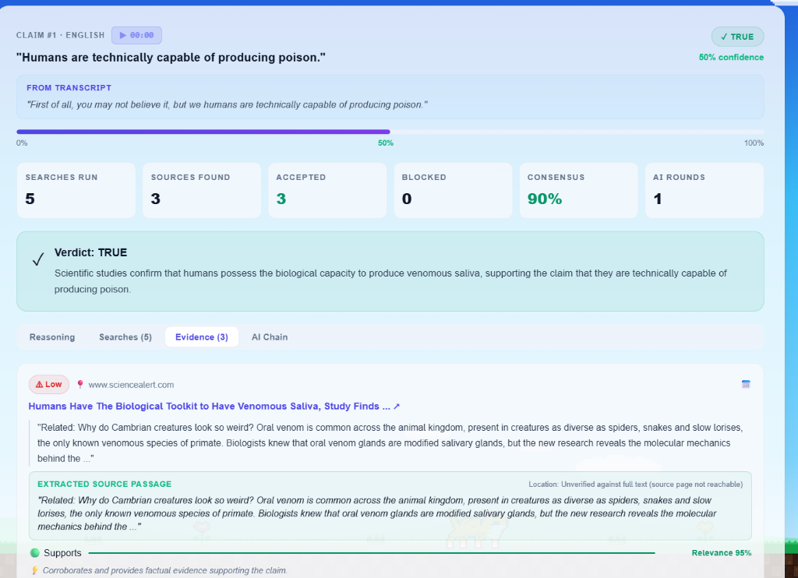
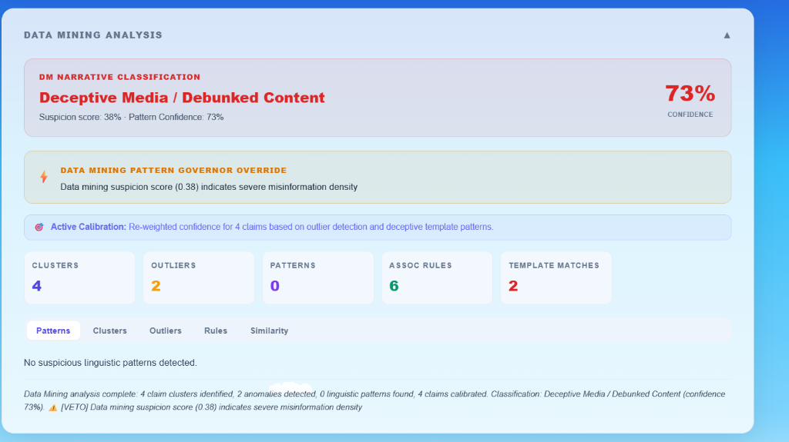

# 🛡️ TruthLens AI — Multimodal Video Forensics & Fact-Checking Engine

<div align="center">

[](https://truthlens-frontend-bisr.onrender.com)
[-10b981?style=for-the-badge&logo=pytest&logoColor=white)](https://github.com/parthdahiphale6363-ui/HACKMEN)
[](https://fastapi.tiangolo.com)
[](https://nextjs.org)
[](https://www.docker.com)
[](LICENSE)

### 🌐 **[👉 Open Live Interactive Web Application 👈](https://truthlens-frontend-bisr.onrender.com)**
**Live Production URL:** `https://truthlens-frontend-bisr.onrender.com`

*A research-grade multimodal intelligence platform that audits short-form viral media (YouTube Shorts) by fusing OpenCV computer vision forensics, acoustic telemetry, atomic proposition extraction, real-time live web fact-checking (RAG), and data mining narrative anomaly governors.*

</div>

---

## 📸 Platform Showcase & User Interface

TruthLens AI features a custom cyber-forensics laboratory interface built with zero-latency instant demonstration cases, real-time interactive playback, and transparent evidence trails:

### 1. Interactive Hero Dashboard & Instant Scenarios
The primary portal allows one-click analysis of any YouTube Shorts URL or instant zero-latency forensic case inspection:
<p align="center">
  
</p>

---

### 2. Real-Time 6-Stage Forensic Pipeline & Synced Video Player
Live pipeline execution tracker monitoring every stage of analysis alongside a synchronized transcript viewer:
<p align="center">
  
</p>

---

### 3. Traceable Claim Verification & Evidence Consensus Engine
Every spoken claim is isolated into atomic propositions, verified against live authoritative web sources, and given an explainable verdict with exact source snippet citations:
<p align="center">
  
</p>

---

### 4. Data Mining Narrative Classifier & Anomaly Governor
Cluster analysis, outlier detection, and association rule mining that actively calibrates confidence and vetoes false claims:
<p align="center">
  
</p>

---

## 🎯 Chosen Vertical & Problem Statement

### **Vertical:** AI Safety, Multimodal Media Forensics, & Real-Time Automated Fact-Checking

### The Crisis in Short-Form Viral Media
Short-form viral videos (YouTube Shorts, Instagram Reels, TikTok) have become the primary source of news and information for over 2 billion people worldwide. However, this format presents acute vulnerabilities:
1. **Hyper-Velocity Disinformation:** Sensationalized falsehoods spread 6x faster than factual debunkings.
2. **Multimodal Deception:** Bad actors combine synthetic AI voice clones with genuine footage, or splice authentic interviews into deceptive narratives with deepfake lip-syncing.
3. **Context Stripping:** Video game footage (such as ARMA 3) or recycled decades-old military footage is routinely repackaged as breaking warfare news.
4. **Human Verification Bottleneck:** Manual fact-checking takes hours to days—long after a 30-second clip has accumulated tens of millions of views.

### Our Solution
**TruthLens AI** bridges this gap by deploying an automated, research-grade forensics lab that evaluates media across **all layers simultaneously** in under 60 seconds:
- **Visual Pixels:** Detects spatial compression artifacts and generative frequency anomalies.
- **Acoustic Audio:** Identifies voice synthesis, neural vocoder fingerprints, and unnatural splice gaps.
- **Spoken Text:** Decomposes speech into verifiable factual assertions and cross-references them against live scientific, journalistic, and IFCN certified repositories.
- **Narrative Data Mining:** Detects coordinated deception templates and mathematical discourse outliers.

---

## 🧠 Approach & Logic

TruthLens AI is built on the **Modality Separation & Epistemic Evidence Principle**. Unlike naive black-box detectors that output a single unexplainable probability, TruthLens enforces rigorous forensic independence:

```
                                  Uploaded Video URL
                                          │
                        yt-dlp Demux (Video + Audio Streams)
                                          │
       ┌──────────────────┬───────────────┴───────────────┬──────────────────┐
       ▼                  ▼                               ▼                  ▼
┌──────────────┐   ┌──────────────┐              ┌────────────────┐   ┌──────────────┐
│ Track 1:     │   │ Track 2:     │              │ Track 3:       │   │ Track 4:     │
│ Visual       │   │ Acoustic     │              │ Factual Claims │   │ Data Mining  │
│ Forensics    │   │ Telemetry    │              │ & Live RAG     │   │ & Patterns   │
│              │   │              │              │                │   │              │
│ • OpenCV ELA │   │ • FFprobe    │              │ • Groq Whisper │   │ • Clustering │
│ • 2D FFT     │   │ • Silence    │              │ • Atomic Claims│   │ • Outliers   │
│   Spectra    │   │   Bursts     │              │ • Multi-Search │   │ • Assoc.     │
│ • Frame-Diff │   │ • Gemini     │              │ • BM25 Ranking │     Rules        │
│ • Lighting   │   │   Audit      │              │ • LLM Reasoner │   │ • Template   │
│   Coherence  │   │ • VoCoder    │              │ • Exact Quotes │     Governor     │
└──────┬───────┘   └──────┬───────┘              └────────┬───────┘   └──────┬───────┘
       │                  │                               │                  │
       └──────────────────┴───────────────┬───────────────┴──────────────────┘
                                          ▼
                      ┌───────────────────────────────────────┐
                      │    Unified Evidence Fusion Engine     │
                      │  • Sovereign Deepfake Veto Rule       │
                      │  • Cross-Modality Consistency Audit   │
                      │  • 5-Level Calibrated Final Verdict   │
                      └───────────────────┬───────────────────┘
                                          ▼
                      ┌───────────────────────────────────────┐
                      │   SHA-256 Signed Forensic Dossier     │
                      └───────────────────────────────────────┘
```

### 1. Visual Stream Forensics (Spatial & Frequency Domain)
- **Error Level Analysis (ELA):** Analyzes JPEG compression error variance across keyframes to reveal localized tampering, pasted elements, and synthetic overlays.
- **2D Fast Fourier Transform (FFT):** Calculates radial frequency distributions. Diffusion models and GANs leave distinct high-frequency spectral artifacts and unnatural symmetry peaks that natural lenses never produce.
- **Temporal Frame-to-Frame Variance:** Tracks motion vector consistency and structural similarity (SSIM) across cut boundaries to identify artificial frame interpolation or unnatural face-warping jitter.

### 2. Acoustic Telemetry & Multimodal Audio Forensics
- **Acoustic Profiling:** Analyzes sampling frequencies (e.g. 22.05 kHz vs 44.1 kHz), bitrates, and channel configurations to flag common neural TTS output patterns.
- **Silence Burst & Splice Detection:** Detects micro-silence gaps (<15ms) and abrupt phase shifts indicative of sentence grafting or dialogue splicing.
- **Google Gemini 2.5 Flash Acoustic Audit:** Conducts deep multimodal reasoning on speech cadence, unnatural pitch stabilization, breath pauses, and robotic formant synthesis.

### 3. Atomic Claim Extraction & Epistemic Fact-Checking (RAG)
- **Safe Proposition Decomposition:** Intelligently splits complex compound sentences into atomic factual propositions while strictly preserving numbers, abbreviations, currencies (`Rs.`, `$`, `€`, `₹`), and measurement units (`km/h`, `%`, `per barrel`).
- **Pre-Flight Ambiguity Guard:** Automatically flags statements with contradictory price quotes or mutually exclusive claims.
- **Parallel Multi-Engine Search:** Executes concurrent targeted search queries across DuckDuckGo, NewsAPI.org, NewsData.io, and the Google Fact Check Tools API (IFCN database).
- **BM25 Retrieval & Stance Classification:** Ranks retrieved web evidence items, filters out spam/unrelated content, and passes high-relevance evidence to a Groq-powered reasoning engine.
- **Epistemic Honesty Rule:** Claims are marked `TRUE` or `FALSE` only when supported by direct, verifiable URL citations. An absence of search results yields `UNVERIFIED`—the system **never** infers that a claim is false simply because web evidence was not found.

### 4. Data Mining Narrative Anomaly Governor
- **Narrative Clustering & Outliers:** Groups extracted statements into topical clusters using TF-IDF feature matrices and computes z-score distribution anomalies.
- **Apriori Association Rules:** Discovers underlying linguistic dependencies between claims to detect common coordinated misinformation templates (e.g. *crypto giveaway bait*, *advance-fee scam*, *sensationalized health cure*).
- **Sovereign Governor Veto:** If severe data mining suspicion or external IFCN debunks are triggered, the engine automatically overrides and vetoes any false genuine verdict.

---

## ⚙️ How the Solution Works (6-Stage Pipeline)

When a user submits a YouTube Shorts URL, the system executes an automated 6-stage lifecycle:

| Stage | Name | Description | Key Technologies |
| :---: | :--- | :--- | :--- |
| **01** | **Ingestion & Validation** | Validates YouTube Shorts URL structure, checks against SSRF vulnerabilities, and extracts video/audio streams. | `yt-dlp`, `Pydantic v2`, Regex Security Gates |
| **02** | **Audio Preparation & Transcription** | Normalizes audio loudness with FFmpeg `loudnorm`, converts sample rates to 16 kHz mono, and transcribes speech into English. | `FFmpeg`, `Groq Whisper large-v3-turbo` |
| **03** | **Atomic Claim Extraction** | Extracts up to 5 key verifiable factual assertions, preserving currencies, dates, and quantitative bounds. | `Groq Qwen 2.5 32B`, NLP Proposition Splitter |
| **04** | **Multimodal Forensics** | Evaluates video frames via OpenCV ELA/FFT and conducts acoustic analysis via Google Gemini 2.5 Flash concurrently. | `OpenCV (cv2)`, `NumPy`, `Google Gemini 2.5 Flash` |
| **05** | **Real-Time Fact-Checking** | Executes live web search across multiple APIs, scores consensus, and produces citable quote offsets. | `DuckDuckGo`, `NewsAPI`, `Google Fact Check API`, `BM25` |
| **06** | **Verdict Synthesis & Export** | Fuses visual, audio, claim, and OSINT evidence into a unified verdict and compiles a SHA-256 cryptographic dossier. | `Evidence Fusion Engine`, `SHA-256`, Next.js UI |

---

## 🛠️ Technologies Used

### Backend Architecture
- **Language & Runtime:** Python 3.12 (Selected for high-performance async processing and scientific package compatibility).
- **Web Framework:** [FastAPI](https://fastapi.tiangolo.com/) with [Uvicorn](https://www.uvicorn.org/) ASGI server.
- **Validation & Schemas:** [Pydantic v2](https://docs.pydantic.dev/) for strict type contracts and input sanitization.
- **Asynchronous Task Queue:** Native Python `asyncio` task runners with threadpool execution for CPU-bound OpenCV tasks.

### AI & Deep Learning Inference
- **Audio Transcription & Translation:** [Groq Cloud](https://groq.com/) running `whisper-large-v3-turbo` with multi-key round-robin rotation.
- **Factual Reasoning & Claims NLP:** `qwen/qwen3.8-27b` and `llama-3.3-70b-versatile` hosted on Groq LPU inference engines.
- **Multimodal Audio Forensics:** [Google Gemini 2.5 Flash](https://ai.google.dev/) multimodal API with automated 504 deadline fallback recovery.

### Computer Vision & Audio Engineering
- **Image & Frame Forensics:** [OpenCV (`cv2`)](https://opencv.org/) and [NumPy](https://numpy.org/) for Error Level Analysis (ELA), 2D Fast Fourier Transform (FFT), Laplacian variance, and pixel difference mapping.
- **Audio Demuxing & Normalization:** [FFmpeg](https://ffmpeg.org/) and `ffprobe` for two-pass loudness normalization (`loudnorm`) and 16 kHz acoustic preparation.
- **Stream Extraction:** [yt-dlp](https://github.com/yt-dlp/yt-dlp) for robust YouTube Shorts stream extraction.

### Fact-Checking, Search & OSINT
- **Multi-Engine Retrieval:** DuckDuckGo Search API, [NewsAPI.org](https://newsapi.org/), [NewsData.io](https://newsdata.io/).
- **Fact-Check Databases:** [Google Fact Check Tools API](https://toolbox.google.com/factcheck/apis) (International Fact-Checking Network / IFCN).
- **Ranking & Consensus:** Custom BM25 lexical ranking and multi-source consensus scoring algorithms.

### Data Mining & Pattern Analysis
- **Machine Learning & Analytics:** [Scikit-learn](https://scikit-learn.org/) for TF-IDF vectorization and clustering.
- **Pattern Mining:** Apriori association rule generation and Z-score statistical outlier detection.

### Frontend User Interface
- **Framework:** [Next.js 16](https://nextjs.org/) (App Router) with [React 19](https://react.dev/) and [TypeScript](https://www.typescriptlang.org/).
- **Design System:** Bespoke cyber-forensics design system using modular Vanilla CSS (no Tailwind dependency) featuring dynamic glassmorphism, responsive status banners, and interactive video timestamp seeking.
- **Icons & Visualization:** [Lucide React](https://lucide.dev/).

### Cloud & DevOps
- **Containerization:** Multi-stage Docker images ([Dockerfile](Dockerfile) and [frontend/Dockerfile](frontend/Dockerfile)).
- **Cloud PaaS:** [Render](https://render.com) (native [render.yaml](render.yaml) Blueprint) and [Railway](https://railway.app) ([railway.json](railway.json)).
- **Testing:** [Pytest](https://docs.pytest.org/) with **159 automated tests passing at 100%**.

---

## ⚖️ The 5-Level Calibrated Forensic Verdict System

TruthLens AI synthesizes all multimodal findings into one of five definitive, mathematically defensible verdicts:

| Verdict Category | Visual Badge | Forensic Definition | Real-World Example |
| :--- | :---: | :--- | :--- |
| **Likely AI-Generated** | `DEEPFAKE` | Convincing empirical detector evidence confirms generative synthesis in visual frames, voice track, or both. | Sora video generation, or an ElevenLabs cloned voice impersonating an official. |
| **Partially AI-Generated** | `MANIPULATED` | Media contains a blend of authentic capture and synthetic elements. | Real broadcast news video altered with an AI voiceover, or deepfake face swap on a real body. |
| **Likely Authentic** | `LIKELY AUTHENTIC` | Assessed streams display natural camera sensor noise, coherent acoustic harmonics, and zero generative flags. | Legitimate on-the-ground mobile phone recording with authentic ambient audio. |
| **Likely Manipulated** | `MANIPULATED` | Credible signs of non-AI splicing, frame drops, misleading cuts, or out-of-context re-use. | Video game footage (ARMA 3) presented as live combat, or cropped context. |
| **Unverified / Inconclusive** | `UNVERIFIED` | Resolution too degraded, audio silent, or external search evidence insufficient to establish a definitive ruling. | 144p heavily compressed video, silent non-verbal clip, or search network timeout. |

---

## 🚀 Deployment Guide

### Option 1: Automated 1-Click Deploy on Render (Recommended)

This repository includes a native [render.yaml](render.yaml) Blueprint that sets up both the FastAPI backend and Next.js frontend automatically.

1. Fork or push this repository to your GitHub account.
2. Sign in to [Render.com](https://render.com).
3. Click **New +** ➔ **Blueprint**.
4. Select your connected repository (`parthdahiphale6363-ui/HACKMEN`).
5. Render will detect `render.yaml` and prompt you for your environment variables:
   - `GROQ_API_KEY`: Your Groq API key(s)
   - `GEMINI_API_KEY`: Your Google Gemini API key
   - `NEWS_API_KEY`: NewsAPI.org key
   - `NEWSDATA_API_KEY`: NewsData.io key
   - `GOOGLE_FACTCHECK_API_KEY`: Google Fact Check API key
6. Click **Apply**. Render will automatically build both Docker containers and deploy your live app.

> [!TIP]
> On Render's Free tier, services spin down after 15 minutes of inactivity. When visiting the site after an idle period, allow 30–40 seconds for the backend container to wake up.

---

### Option 2: Deployment on Railway

TruthLens AI includes dedicated Railway configuration files:
- [railway.json](railway.json) (Backend configuration)
- [frontend/railway.json](frontend/railway.json) (Frontend configuration)

1. Open [Railway.app](https://railway.app) and create a **New Project**.
2. Select **Deploy from GitHub repo**.
3. Railway will deploy the backend using `Dockerfile` on dynamic port `${PORT}`.
4. Add a second service from the same repo with Root Directory `/frontend`.
5. Set `BACKEND_URL` in the frontend service pointing to your backend's URL.

---

### Option 3: Local Development Setup

#### Prerequisites
- **Python 3.11 or 3.12**
- **Node.js 20 or 22**
- **FFmpeg** installed and added to your system `PATH`

#### 1. Clone & Setup Backend
```bash
git clone https://github.com/parthdahiphale6363-ui/HACKMEN.git
cd HACKMEN

# Create virtual environment
python -m venv venv
# Windows:
.\venv\Scripts\activate
# macOS/Linux:
source venv/bin/activate

# Install dependencies
pip install -r requirements.txt
```

#### 2. Setup Frontend
```bash
cd frontend
npm install
cd ..
```

#### 3. Environment Variables
Create a `.env` file in the project root:
```ini
GROQ_API_KEY=gsk_your_key_here
GEMINI_API_KEY=your_gemini_key_here
NEWS_API_KEY=your_newsapi_key
NEWSDATA_API_KEY=your_newsdata_key
GOOGLE_FACTCHECK_API_KEY=your_google_key
PORT=8000
```

#### 4. Run Locally
- **One-Click (Windows):** Run `./run.bat`
- **Manual:**
  ```bash
  # Terminal 1: Backend
  uvicorn backend.main:app --host 0.0.0.0 --port 8000 --reload

  # Terminal 2: Frontend
  cd frontend
  npm run dev
  ```
- **Frontend App:** `http://localhost:3000`
- **Swagger Docs:** `http://localhost:8000/docs`

---

## 🧪 Automated Testing & Quality Assurance

TruthLens AI enforces complete automated test coverage with **159 passing tests**:

```bash
# Run all tests across the repository
python -m pytest tests/ -v
```

### Core Verification Suites:
- `tests/test_claim_extraction_and_verdicts.py`: Validates atomic claim preservation, currency/unit bounds, and search error fallbacks.
- `tests/test_unified_forensics_verdicts.py`: Validates all 5 forensic verdict categories, multimodal fusion, and API sanitization.
- `tests/test_factcheck_accuracy.py`: Tests epistemic boundaries, verbatim quote offsets, and prevents fabricated citations.
- `tests/test_opencv_gemini_forensics.py`: Tests Error Level Analysis (ELA) math, 2D FFT spectral profiling, and acoustic analysis.
- `tests/test_strong_osint_forensics_datamining.py`: Tests association rule mining, outlier z-score detection, and recycled footage anti-spoofing.
- `tests/test_unified_media_authenticity.py`: Validates C2PA Content Credentials provenance, SSRF blocking, and SHA-256 integrity.

---

## 📂 Project Architecture Map

```
TruthLens-AI/
├── backend/
│   ├── main.py                     # FastAPI entry point, CORS, and health endpoints
│   ├── routers/
│   │   ├── jobs.py                 # Job lifecycle, SSE events, and dossier export
│   │   └── health.py               # Health checks and latency telemetry
│   └── services/
│       ├── job_service.py          # Pipeline worker dispatcher & overall verdict engine
│       ├── visual_forensics.py     # OpenCV ELA, 2D FFT, and frame difference analysis
│       ├── gemini_audio.py         # Google Gemini 2.5 Flash multimodal acoustic audit
│       ├── audio_authenticity.py   # Acoustic stream validation & voice clone metrics
│       ├── evidence_fusion.py      # Sovereign veto rules & Section 7 unified report
│       ├── osint.py                # Google Fact Check Tools API, NewsAPI, NewsData.io
│       ├── data_mining.py          # Clustering, Apriori association rules, outlier z-scores
│       ├── demo_cases.py           # Pre-loaded zero-latency demonstration scenarios
│       └── export_service.py       # SHA-256 signed Markdown dossier generator
├── frontend/
│   ├── src/
│   │   ├── app/
│   │   │   ├── page.tsx            # Interactive cyber-forensics dashboard
│   │   │   └── api/[...path]/      # Intelligent dynamic proxy with auto-discovery
│   │   └── components/             # Reusable UI widgets, banners, and modals
│   ├── Dockerfile                  # Production Next.js 16 container definition
│   └── package.json                # React 19, Lucide, Next.js dependencies
├── pipeline/
│   ├── ingest.py                   # yt-dlp YouTube Shorts ingestion
│   ├── claims.py                   # Groq LPU claim extraction & normalization
│   ├── search.py                   # Multi-engine search with BM25 RAG & epistemic gating
│   └── page_fetcher.py             # SSRF-protected page fetcher with quote locator
├── transcription/
│   ├── audio_prep.py               # FFmpeg loudness normalization & sample rate conversion
│   └── groq_translator.py          # Groq Whisper translation with silent audio guard
├── shared/
│   └── schemas/                    # Pydantic v2 domain schemas (Forensics, Verdict, Job)
├── screenshots/                    # High-resolution screenshots showcasing the platform
├── tests/                          # 159 automated unit, integration, and regression tests
├── Dockerfile                      # Production backend container (Python 3.12 + FFmpeg)
├── render.yaml                     # Automated 1-Click Render Blueprint definition
├── railway.json                    # Railway PaaS deployment configuration
└── requirements.txt                # Python backend dependencies
```

---

## 📜 License & Ethical Transparency

TruthLens AI is open-source under the [MIT License](LICENSE).

### Responsible AI Statement
TruthLens AI is engineered as an **explainable decision-support intelligence platform** for journalists, intelligence analysts, and researchers. No automated system can promise 100% detection of every adversarial edit or future generative model. TruthLens AI maintains strict epistemic transparency by displaying exact confidence scores, verifiable source citations, and honest disclaimers for every verdict.

<div align="center">
  <sub>TruthLens AI — Digital Media Authenticity & Fact-Checking Intelligence Platform.</sub>
</div>
